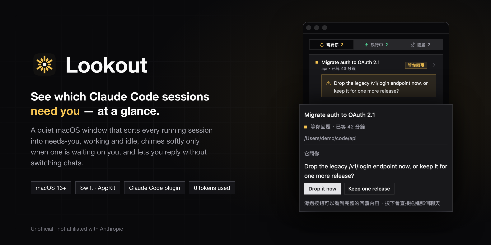
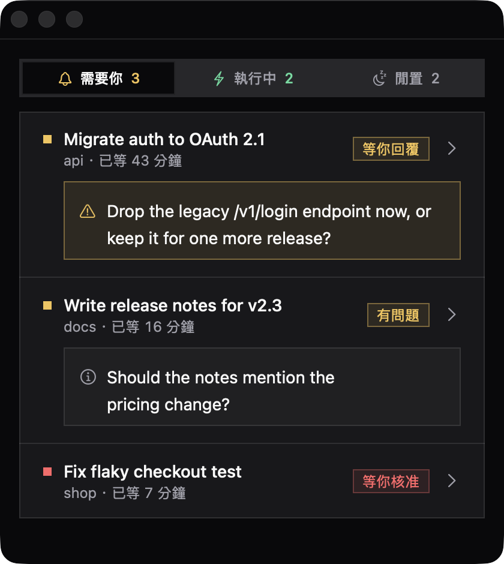
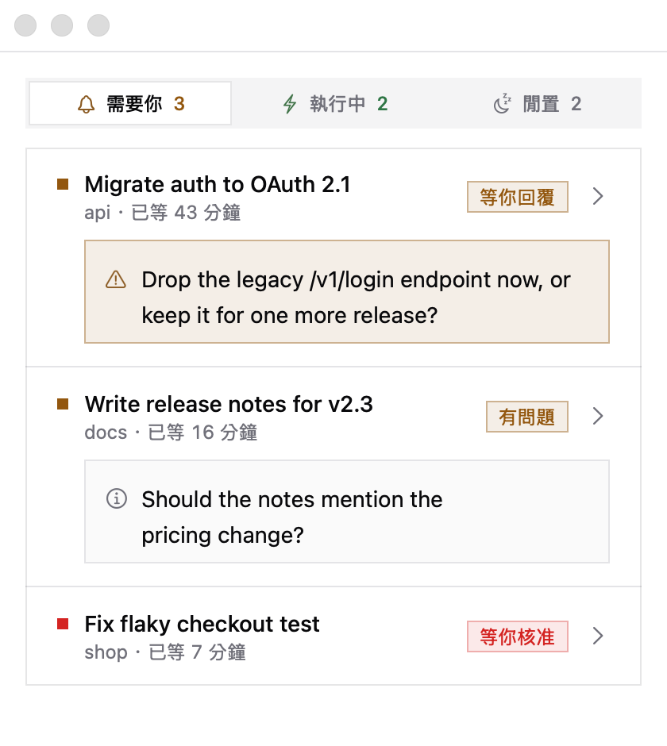
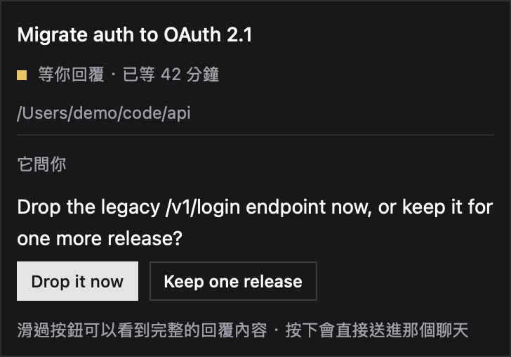

<p align="center">
  
</p>

<p align="center">
  <b>English</b> · <a href="README.zh-TW.md">繁體中文</a>
</p>

<p align="center">
  
  
  
</p>

# Lookout

**A quiet macOS window that tells you which Claude Code sessions need you.**

When you run several Claude Code chats at once, the hard part isn't the work — it's noticing
that one of them stopped twenty minutes ago to ask you something. Lookout sits beside your
other windows and sorts every session into three groups:

| Group | What's in it |
|---|---|
| **需要你** · Needs you | A session is waiting on you: it asked a question it can't continue without, it asked an open question, or it's stuck on a permission prompt. The one that has waited longest is on top. |
| **執行中** · Working | Sessions that are running right now. |
| **閒置** · Idle | Finished, nothing waiting for you. |

It chimes softly when a session starts needing you, or finishes a long run, and lets you answer a session's
suggested replies straight from the window — no switching chats.

> Lookout is an independent, unofficial project. It is not made by, affiliated with, or
> endorsed by Anthropic. "Claude" and "Claude Code" are trademarks of Anthropic.

## Screenshots

<table>
  <tr>
    <td width="50%"></td>
    <td width="50%"></td>
  </tr>
  <tr>
    <td align="center">Dark</td>
    <td align="center">Light — follows your system appearance</td>
  </tr>
</table>

<p align="center">
  <br>
  <sub>Hover over a row to see everything: the full title, folder, the question — and its suggested replies.</sub>
</p>

All screenshots use made-up demo sessions.

## Features

- **Three groups, at a glance** — needs you, working, idle, with a count on each tab (⌘1 ⌘2 ⌘3).
- **Reply from the window** — when a session offers reply buttons, press one and Lookout sends
  it into that chat for you. It checks four things before pressing Enter (right chat, empty input
  box, focus in the box, text matches) and stops if any fails, so it never sends to the wrong place
  or on top of your draft. Each question can only be answered once.
- **Click a row to open that chat** in Claude.
- **A soft chime, only when it matters** — two low wooden notes when a session starts needing you;
  one quieter note when a session that ran for 2 minutes or more stops without asking anything
  (it may have reached a point where you should review). Quick back-and-forth stays silent.
  Mute it in the menu: 顯示 → 提示音.
- **Doesn't forget** — Claude may close idle chats in the background (overnight, for example).
  If one was still waiting on you, Lookout keeps showing it until you deal with it.
  Right-click to dismiss it.
- **A switch inside Claude** — a row just above the chat box shows whether Lookout is open,
  with a button to open or close it. `/lookout` does the same. If you leave it on, Lookout comes
  back by itself after a restart, as soon as you open Claude.
- **Uses zero tokens** — Lookout only reads files Claude Code already writes on your Mac.
  It never talks to Claude or the network.

## Requirements

- macOS 13 or later (developed and tested on macOS 26)
- Apple's Command Line Tools, for the Swift compiler — `install.sh` tells you if they're missing
- [Claude Code](https://claude.com/claude-code), with sessions run from the **Claude desktop app**
  for the full experience (see [What works where](#what-works-where))

## Install

### 1. Build and install the app

```bash
git clone https://github.com/jianwei0510/claude-code-lookout.git
cd claude-code-lookout
./install.sh
```

The script builds Lookout from source (about 30 seconds) and installs it to
`~/Library/Application Support/Lookout/`. Nothing is written anywhere else.
Building on your own Mac means macOS doesn't flag the app as downloaded, so there's no
"unidentified developer" warning to click through.

If it says the Swift compiler is missing, run `xcode-select --install`, then run `./install.sh` again.

### 2. Add the switch to Claude

```bash
claude plugin marketplace add jianwei0510/claude-code-lookout
claude plugin install lookout@claude-code-lookout
```

This installs a small Claude Code plugin. It's what opens and closes the window and
brings it back after a restart.

### 3. Turn it on

Open a **new** chat in Claude. Just above the chat box you'll see:

```
○ Lookout 關著  [打開]
```

Press **打開** (open). The Lookout window appears, and the row changes to `● Lookout 開著 [關掉]`.

### 4. Allow replies from the window (optional)

The first time you press a reply button in Lookout, macOS asks for **Accessibility** permission,
because Lookout types the reply into Claude for you. Allow it for **Claude** (Lookout was started
from Claude, so the permission belongs to Claude). Until you allow it, Lookout copies the reply and
opens the chat instead, so you can paste it yourself.

You can change this later in System Settings → Privacy & Security → Accessibility.

## Using it

| To | Do |
|---|---|
| Open or close the window | The button above the chat box, or type `/lookout` |
| Check whether it's open | `/lookout status` |
| See everything about a session | Hover over its row |
| Answer a session | Hover, then press one of its reply buttons |
| Open a session in Claude | Click its row |
| Switch tabs | ⌘1 ⌘2 ⌘3 |
| Change the text size | ⌘+ ⌘− ⌘0 |
| Mute the chime | Menu 顯示 → 提示音 |
| Forget a closed session | Right-click it → 不再顯示這個 session |

`/lookout on` and `/lookout off` work too; `/lookout` on its own toggles.

**About the language:** the window's labels are in Traditional Chinese. Here's what they mean:

| Label | Meaning |
|---|---|
| 需要你 · 執行中 · 閒置 | Needs you · Working · Idle |
| 等你回覆 | Waiting for your reply — it can't continue without you |
| 有問題 | Has a question, but can keep going |
| 等你核准 | Waiting for you to approve a permission prompt |
| 已等 42 分鐘 | Has waited 42 minutes |
| 它問你 | It's asking you |
| 打開 · 關掉 · 開著 · 關著 | Open · Close · Open (state) · Closed (state) |

## What works where

Lookout reads two kinds of files that Claude Code writes on your Mac (`~/.claude/sessions/` and
`~/.claude/projects/`). Some details only exist for sessions run from the Claude desktop app:

| | Claude desktop app | Claude Code in a terminal |
|---|---|---|
| Working / idle | ✓ | ✓ |
| Waiting on a permission prompt | ✓ | ✓ |
| "Waiting for your reply" / "has a question" | ✓ | — shown as idle |
| Reply buttons | ✓ | — |
| Click to open the chat | ✓ | — |

The question detection relies on the summary the desktop app writes at the end of each turn.

## Update

```bash
cd claude-code-lookout
git pull
./install.sh
claude plugin marketplace update claude-code-lookout
claude plugin update lookout@claude-code-lookout
```

`install.sh` restarts Lookout if it was running, so the new version takes over right away.

## Uninstall

```bash
cd claude-code-lookout
./uninstall.sh
claude plugin uninstall lookout@claude-code-lookout
claude plugin marketplace remove claude-code-lookout
```

`uninstall.sh` stops Lookout and deletes `~/Library/Application Support/Lookout/` and its
preferences. Then you can delete the cloned folder.

## Troubleshooting

**The row says `○ Lookout 還沒安裝`** ("not installed yet") — the plugin can't find the app.
Run `./install.sh` in the cloned folder.

**There's no row above the chat box** — the plugin loads when a chat starts. Open a new chat,
and check that `claude plugin list` shows `lookout@claude-code-lookout` as enabled.

**Pressing a reply button only copies it** — Lookout doesn't have Accessibility permission yet.
See [step 4](#4-allow-replies-from-the-window-optional).

**A session I closed keeps showing** — Lookout remembers sessions that were still waiting on you.
Right-click the row → 不再顯示這個 session.

**No sound** — check 顯示 → 提示音 is ticked. Lookout only chimes when a session *starts*
needing you, or stops after running 2 minutes or more — not for every change.

## How it works

```
~/.claude/sessions/<pid>.json           written by each running session, with a heartbeat
                                        → working, idle, waiting on a permission prompt
~/.claude/projects/<folder>/<id>.jsonl  the session's transcript
                                        → did it ask you something, and have you answered?
```

Lookout checks these every two seconds. Transcripts can be hundreds of megabytes, so it reads
each one from the end only until it finds the latest turn summary, then only reads what's added.
It never writes to them.

```
app/        the macOS app (Swift, AppKit) — Lookout.swift, Logo.swift, design tokens, sounds
plugin/     the Claude Code plugin: the switch row and /lookout
docs/       screenshots and DEVELOPMENT.md
tests/      chime_drive.py: plays fake sessions through every state change, checks which ones chime
install.sh  build and install          uninstall.sh  remove everything
```

The look follows **Mono Sharp**, a square-cornered monochrome design system; colors come from
`app/design/mono-sharp.tokens.json`. The chime is synthesized from scratch by
`app/sounds/synth_soft.py` — no sampled or licensed audio.

**[docs/DEVELOPMENT.md](docs/DEVELOPMENT.md)** (Traditional Chinese) explains why each behavior
works the way it does: what was measured, and what went wrong along the way. Plugin tests run with
`claude plugin test plugin`.

## License

[MIT](LICENSE) © 2026 jianwei0510
