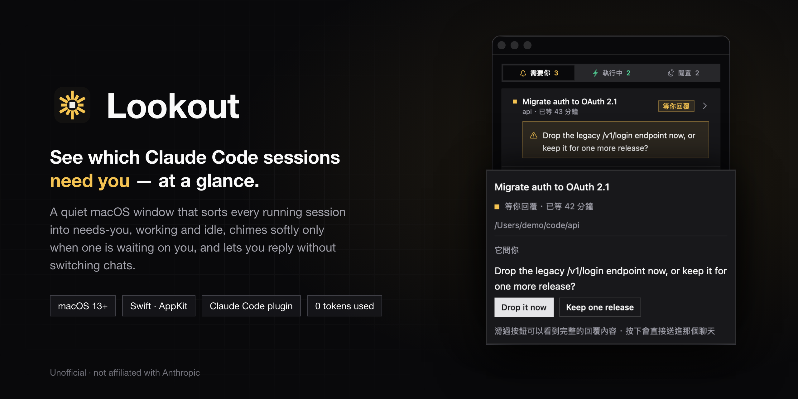
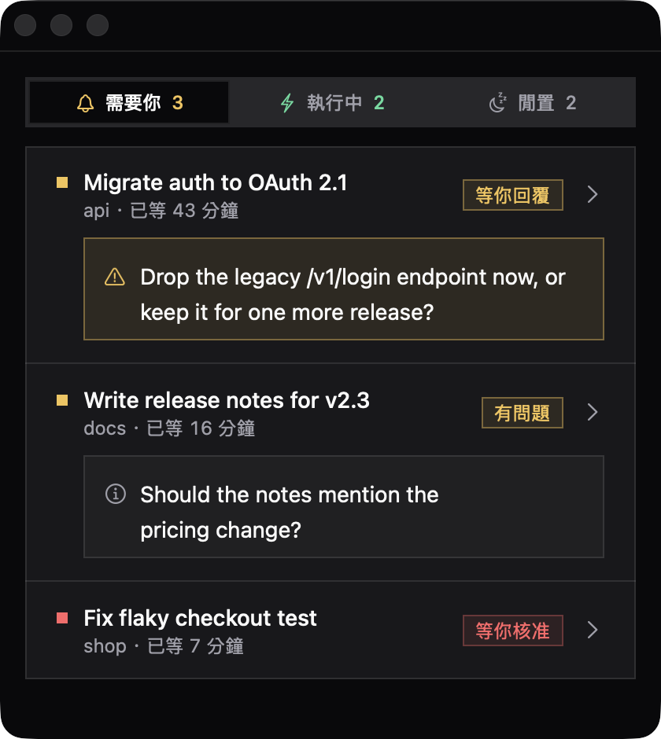
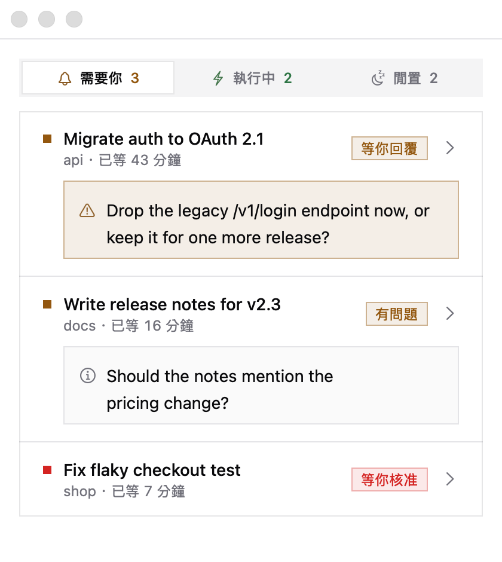
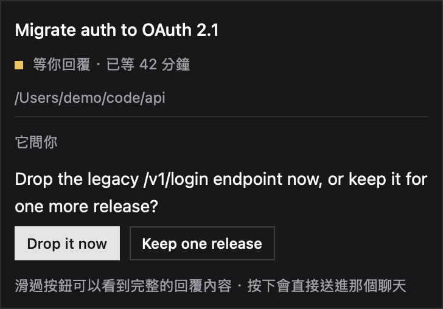

<p align="center">
  
</p>

<p align="center">
  <a href="README.md">English</a> · <b>繁體中文</b>
</p>

# Lookout

**一個安靜的 macOS 視窗，告訴你哪個 Claude Code session 在等你。**

同時開好幾個 Claude Code 聊天時，難的不是工作本身，而是發現其中一個二十分鐘前就停下來問你問題了。
Lookout 放在其他視窗旁邊，把每個 session 分成三區：

| 分區 | 裡面是什麼 |
|---|---|
| **需要你** | 有 session 在等你：問了沒有你就做不下去的問題、問了一個開放的問題，或卡在權限對話框。等最久的排最前面 |
| **執行中** | 正在跑的 session |
| **閒置** | 跑完了，沒有東西在等你 |

它**只在**某個 session 開始需要你的那一刻輕輕響一聲；session 給了建議的回覆時，
可以直接在視窗裡按，不用切換聊天。

> Lookout 是獨立的非官方專案，不是 Anthropic 製作，與 Anthropic 沒有關係，也沒有得到其背書。
> 「Claude」與「Claude Code」是 Anthropic 的商標。

## 畫面

<table>
  <tr>
    <td width="50%"></td>
    <td width="50%"></td>
  </tr>
  <tr>
    <td align="center">深色</td>
    <td align="center">淺色（跟著系統外觀）</td>
  </tr>
</table>

<p align="center">
  <br>
  <sub>滑鼠停在某一列上，就會浮出完整內容：標題、資料夾、問題全文，以及它建議的回覆。</sub>
</p>

所有截圖都是虛構的示範 session。

## 功能

- **三區一眼看完**：需要你、執行中、閒置，每一區都有數量（⌘1 ⌘2 ⌘3 切換）
- **在視窗裡回覆**：session 給了回覆按鈕時，按下去 Lookout 會幫你送進那個聊天。
  按 Enter 之前先確認四件事：開的是對的聊天、輸入框是空的、焦點在輸入框上、貼上的字完全一致。
  任何一項不對就停下來，不會送錯地方，也不會把你打到一半的草稿一起送出去。同一個問題只能回一次
- **點一下那一列**，就在 Claude 裡打開那個聊天
- **只在需要時響**：某個 session 開始需要你時，響兩聲低沉的木琴，其他時候都安靜。
  可以在選單「顯示 → 提示音」關掉
- **不會忘記**：Claude 可能會在背景結束閒置的聊天（例如過夜之後）。
  如果那個聊天還在等你，Lookout 會一直顯示它，直到你處理為止。按右鍵可以不再顯示
- **Claude 裡的開關**：對話框正上方有一列，顯示 Lookout 開著沒有，並附一顆開關按鈕；
  `/lookout` 也能做一樣的事。開關維持開著的話，重新開機後一打開 Claude，Lookout 就會自己回來
- **不花任何 token**：Lookout 只讀 Claude Code 本來就會寫在你電腦上的檔案，
  不跟 Claude 通訊，也不連網路

## 需要什麼

- macOS 13 或更新版本（在 macOS 26 上開發與測試）
- Apple 的 Command Line Tools（用來編譯 Swift）：缺少的話 `install.sh` 會告訴你
- [Claude Code](https://claude.com/claude-code)；要用到全部功能，session 要從 **Claude 桌面版 app** 開
  （見[哪些功能在哪裡能用](#哪些功能在哪裡能用)）

## 安裝

### 1. 編譯並安裝 app

```bash
git clone https://github.com/jianwei0510/claude-code-lookout.git
cd claude-code-lookout
./install.sh
```

這支腳本會從原始碼編譯 Lookout（大約 30 秒），裝到 `~/Library/Application Support/Lookout/`，
不會寫到其他地方。在你自己的電腦上編譯，macOS 就不會把它當成下載來的程式，
所以不會跳出「無法辨識的開發者」警告。

如果它說缺少 Swift 編譯器，先跑 `xcode-select --install`，再跑一次 `./install.sh`。

### 2. 把開關加進 Claude

```bash
claude plugin marketplace add jianwei0510/claude-code-lookout
claude plugin install lookout@claude-code-lookout
```

這會裝一個小小的 Claude Code 外掛，負責開關視窗、以及重新開機後把它帶回來。

### 3. 打開它

在 Claude 裡開一個**新的**聊天，對話框正上方會出現：

```
○ Lookout 關著  [打開]
```

按「打開」，Lookout 視窗就會出現，那一列也會變成 `● Lookout 開著 [關掉]`。

### 4. 允許從視窗回覆（選用）

第一次在 Lookout 裡按回覆按鈕時，macOS 會要求**輔助使用**權限，因為 Lookout 要幫你把回覆打進 Claude。
請允許給 **Claude**：Lookout 是從 Claude 裡啟動的，所以權限算在 Claude 頭上。
還沒允許之前，Lookout 會改成把回覆複製到剪貼簿並打開那個聊天，讓你自己貼上。

之後可以在「系統設定 → 隱私權與安全性 → 輔助使用」更改。

## 使用方式

| 想要 | 做法 |
|---|---|
| 打開或關掉視窗 | 對話框上方那顆按鈕，或打 `/lookout` |
| 看現在開著沒有 | `/lookout status` |
| 看某個 session 的完整內容 | 滑鼠停在那一列上 |
| 回覆某個 session | 滑鼠停在那一列上，按它的回覆按鈕 |
| 在 Claude 裡打開某個 session | 點那一列 |
| 切換分區 | ⌘1 ⌘2 ⌘3 |
| 調整字體大小 | ⌘+ ⌘− ⌘0 |
| 關掉提示音 | 選單「顯示 → 提示音」 |
| 忘掉一個已經關掉的 session | 右鍵 → 不再顯示這個 session |

`/lookout on` 和 `/lookout off` 也可以用；只打 `/lookout` 就是切換。

## 哪些功能在哪裡能用

Lookout 讀 Claude Code 寫在你電腦上的兩種檔案（`~/.claude/sessions/` 和 `~/.claude/projects/`）。
有些資訊只有從 Claude 桌面版 app 開的 session 才有：

| | Claude 桌面版 app | 在終端機裡跑的 Claude Code |
|---|---|---|
| 執行中／閒置 | ✓ | ✓ |
| 卡在權限對話框 | ✓ | ✓ |
| 「等你回覆」／「有問題」 | ✓ | — 顯示成閒置 |
| 回覆按鈕 | ✓ | — |
| 點一下打開聊天 | ✓ | — |

判斷「是不是在問你問題」，靠的是桌面版 app 在每一輪結束時寫下的摘要。

## 更新

```bash
cd claude-code-lookout
git pull
./install.sh
claude plugin marketplace update claude-code-lookout
claude plugin update lookout@claude-code-lookout
```

`install.sh` 發現 Lookout 開著的話會重新啟動它，新版本馬上生效。

## 移除

```bash
cd claude-code-lookout
./uninstall.sh
claude plugin uninstall lookout@claude-code-lookout
claude plugin marketplace remove claude-code-lookout
```

`uninstall.sh` 會關掉 Lookout，並刪除 `~/Library/Application Support/Lookout/` 和它的偏好設定。
之後就可以刪掉 clone 下來的資料夾。

## 疑難排解

**那一列寫著「○ Lookout 還沒安裝」**：外掛找不到 app。在 clone 下來的資料夾裡跑 `./install.sh`。

**對話框上方沒有那一列**：外掛在聊天開始時才載入。開一個新聊天，
並確認 `claude plugin list` 裡 `lookout@claude-code-lookout` 是 enabled。

**按回覆按鈕只會複製**：Lookout 還沒有輔助使用權限，見[第 4 步](#4-允許從視窗回覆選用)。

**已經關掉的 session 一直出現**：Lookout 會記住還在等你的 session。右鍵那一列 → 不再顯示這個 session。

**沒有聲音**：確認「顯示 → 提示音」有打勾。Lookout 只在 session **開始**需要你的那一刻響，不是每次變化都響。

## 運作原理

```
~/.claude/sessions/<pid>.json           每個執行中的 session 自己寫的，有心跳
                                        → 執行中、閒置、卡在權限對話框
~/.claude/projects/<資料夾>/<id>.jsonl   session 的對話紀錄
                                        → 它有沒有問你問題、你回了沒有
```

Lookout 每兩秒看一次。對話紀錄可能有幾百 MB，所以第一次只從尾端往前讀，找到最後一輪的摘要就停，
之後只讀新增的部分。它從不寫入這些檔案。

```
app/        macOS app（Swift、AppKit）：Lookout.swift、Logo.swift、design tokens、音效
plugin/     Claude Code 外掛：對話框上方的開關列與 /lookout
docs/       截圖與 DEVELOPMENT.md
install.sh  編譯並安裝          uninstall.sh  全部移除
```

外觀照 **Mono Sharp**，一套直角、單色的 design system；顏色來自 `app/design/mono-sharp.tokens.json`。
提示音由 `app/sounds/synth_soft.py` 從零合成，沒有用任何取樣或授權音源。

**[docs/DEVELOPMENT.md](docs/DEVELOPMENT.md)** 說明每一個行為為什麼長這樣：量過什麼、踩過什麼坑。
外掛的測試用 `claude plugin test plugin` 跑。

## 授權

[MIT](LICENSE) © 2026 jianwei0510
